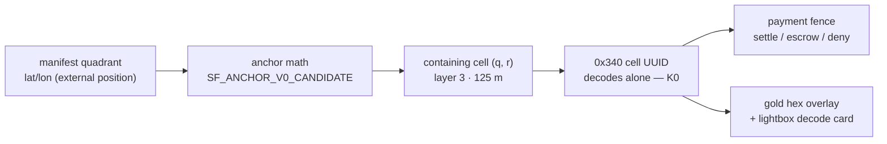

<!--
Ghost Catalog Header
file_id: SOM-DOC-10657-v1.0.0
name: GEOHEX.md
description: Real GeoHex cell assignment for the SF isometric map — how quadrants get gyst-hex 0x340 cells, and the bounds on the claim
project_id: SOMACOSF-ISO
category: geohex
tags: [geohex, gyst-hex, anchor-law, isometric, payments]
created: 2026-11-07
version: 1.0.0
-->

# GeoHex on the isometric map — real cells, honestly bounded

Each quadrant in `map/manifest.json` carries a lat/lon from the map's own
source data. `geohex.js` assigns the quadrant the GeoHex cell that
**contains** that point, using the estate codec (gyst-hex/1.0.0, type
`0x340`, ns `0x3e7`) and the estate candidate anchor. The cell UUID decodes
back to `(q, r, layer, domain)` with no lookup. Payments in
`geohex-pay.js` fence to that cell UUID — replacing the earlier
`geohex:sf:iso:{qx}_{qy}` string, which was a label, not a GeoHex cell.

## The rules it follows

- **Anchor Law**: position comes from outside the UUID. Here the external
  source is the manifest's per-quadrant lat/lon; the UUID carries only
  identity `(q, r, layer, domain)`. Polygons and centroids are derived
  from anchor + axial math, never stored as canonical.
- **Anchor**: `SF_ANCHOR_V0_CANDIDATE` — origin 37.785, −122.4,
  orientation 0°, layer-0 size 1000 m halved per layer, WGS84-G1762.
  Status: **CANDIDATE_NOT_RATIFIED**. If a corrected anchor is ratified,
  every assignment re-derives from the manifest; nothing breaks, because
  nothing here is a stored canonical position.
- **Assignment layer 3** (125 m centre-to-vertex). Quadrant pitch measured
  from the manifest: ~100 m (qx steps, latitude) × ~200 m (qy steps,
  longitude), so neighbouring quadrants sometimes share a cell — that is
  containment working, not a collision.

## Measured on the shipped code (2026-11-07)

- Encoder parity: JS `cellUuid` byte-identical to the Python reference
  codec (`cad-ingest/hexuuid.py`) on 24/24 cases incl. int16 extremes.
- Assignment: 1,287 quadrants → **636 distinct cells**; 544 cells hold
  more than one quadrant; max 4 quadrants in one cell.
- Containment: every quadrant point lies inside its assigned cell polygon
  — 0 failures / 1,287; max point-to-centroid distance 123.7 m (< 125 m
  cell size).
- Fence semantics: same quadrant → same cell (deterministic); a quadrant
  ~9 km away → different cell (a spend there is denied).

## What this is not

- Not ratified minting: the anchor is a candidate awaiting the founder's
  ruling on orientation / base-size / epoch.
- Not a claim about the map imagery: the tiles are generated pixel art
  over a real lat/lon corridor grid; the GeoHex layer is exact about the
  grid, and says nothing about the pictures.
- Not the upstream author's work: the map is Justin Chavez's (this repo is
  a fork, and neither repo carries a license file). The GeoHex layer is
  SoMaCo's addition.
